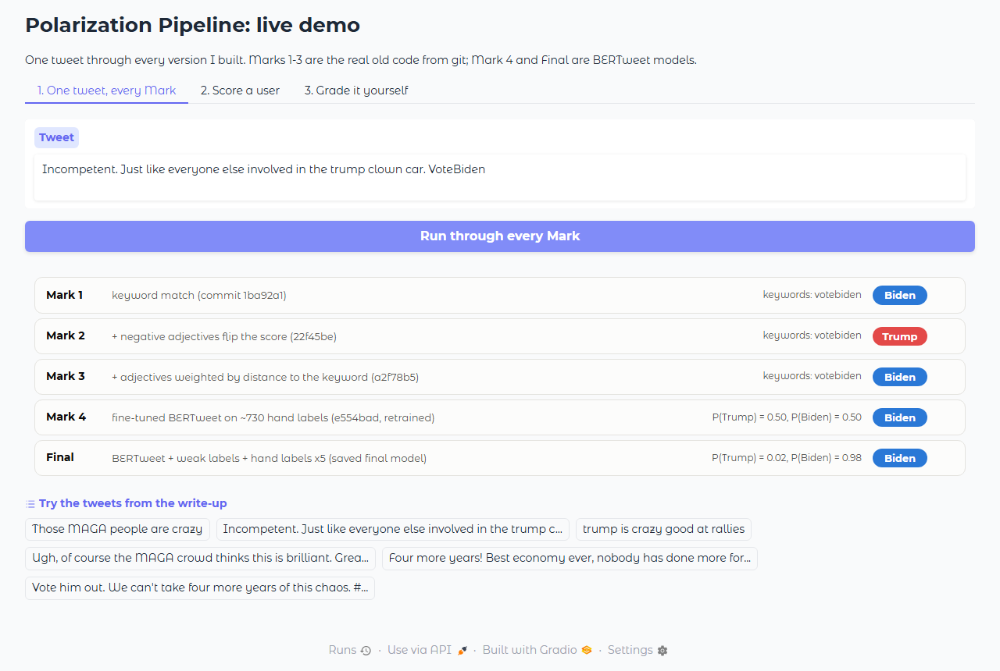

# Live demo

One tweet goes through every version of the pipeline I built, side by side, so you can see each one get better
(or break something).



## Run it

```bash
pip install -r requirements.txt        # main pipeline deps
pip install -r demo/requirements.txt   # + gradio for the web UI
python demo/app.py                     # open http://127.0.0.1:7860
```

- `python demo/app.py --cli "your tweet here"` prints every version's call in the terminal, no browser needed
- `python demo/app.py --share` also makes a temporary public link (lasts ~1 week) if someone wants to try it remotely

Works on CPU; a GPU just makes it snappier. Needs the three model files: `model/mark7/best_model.pt` (Mark 7),
`model/bertweet_finetuned/best_model.pt` (old final) and `model/mark4_rerun/mark4_seed1.pt` (Mark 4). They're ~540 MB
each, too big for GitHub, so they live outside git. `python main.py` retrains Mark 7 from the CSVs.

## The three tabs

1. **One tweet, every Mark.** Marks 1-3 are the actual old code from git (`demo/marks/`, copied unchanged from
   commits 1ba92a1, 22f45be and a2f78b5). Mark 4 is commit e554bad's model, retrained. Old final is the collapsed checkpoint. Mark 7 is the fix.
   Try "Those MAGA people are crazy" (the bug that started Mark 2) and the clown-car tweet (the regression Mark 2
   caused and Mark 3 fixed).
2. **Score a user.** Paste a few tweets, get the real polarization formula from `stage4_5_user_analysis.py` and see
   where that user would sit among the 27,965 users from the Mark 7 run. The copy-paste bot example shows why Mark 4's
   ranking was broken.
3. **Grade it yourself.** Draws random tweets from the 169-tweet held-out test set (hand-labeled, never trained on)
   and keeps a running tally of which versions got it right.

## Known limitations

Mark 7 still whiffs on some tweets ("Those MAGA people are crazy" is a coin flip it loses). Its spam output works now but
isn't great: it caught 6 of 14 spam tweets in the test set, with 6 false alarms out of 155. The demo ignores it for stance.
